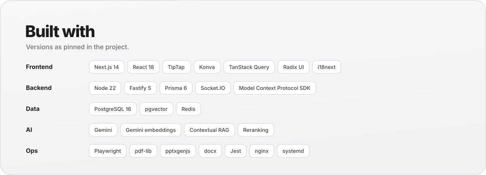
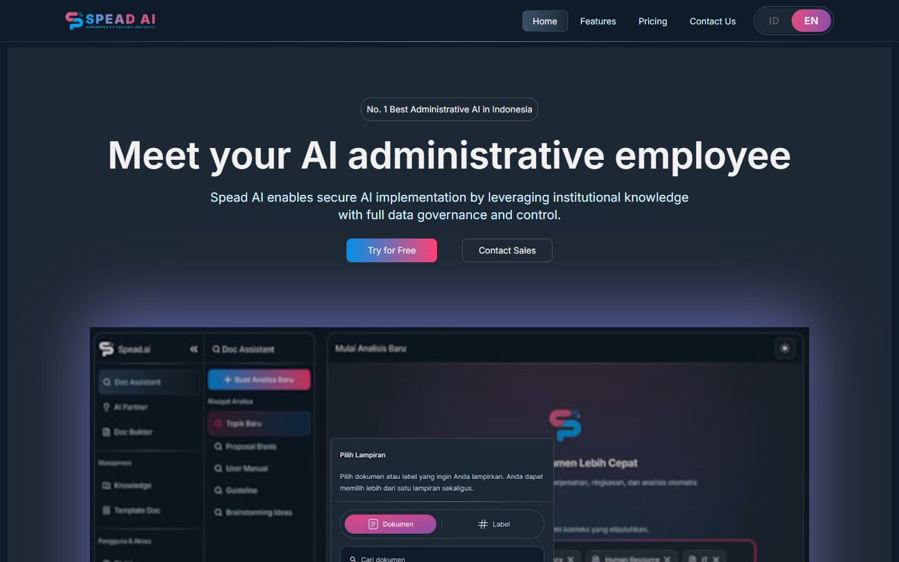

<!-- Showcase repository: the product is real and in use, its source code is private. -->

<a href="https://spead.ai"><picture><source media="(prefers-color-scheme: dark)" srcset="assets/banner-dark.svg"></picture></a>

<a href="https://spead.ai"><b>Open spead.ai</b></a> · <a href="https://github.com/nugrahalabib">More of my work</a> · <a href="https://nugrahalabib.com">nugrahalabib.com</a> · <a href="mailto:nugrahalabib@gmail.com">Email</a>

## Overview

Spead AI is an AI workspace for organisations. Staff chat with an AI Partner that cites its sources, ask questions over the company's own documents, and create documents, slide decks and infographics from templates and letterheads.

Generic language models do not know a company's templates, approval chains or past reports. Spead AI indexes those documents, lets admins approve what enters the knowledge base, and keeps each company's data and agent workspace separate from every other company.

The product started as a 2025 prototype and moved to production in 2026. It is built for private cloud or on-premise deployment, for government bodies, state-owned enterprises and regulated companies. Spead AI was incubated at Caliana Indonesia and graduated from the Google for Startups: AI Solution Lab Program 2025.

| | |
| --- | --- |
| **Status** | Running at [spead.ai](https://spead.ai) |
| **Role** | Founded and led by Nugraha Labib Mujaddid as Founder & Lead AI Engineer, from the first prototype to the production product. |
| **Period** | Since Nov 2025 |
| **Source** | Private. This repository presents the product; the code is not published. |

<picture><source media="(prefers-color-scheme: dark)" srcset="assets/features-dark.svg"></picture>

Features as text

- **AI Partner chat.** Streaming chat that answers from the company's own documents and shows citations next to each answer.
- **Doc Assistant.** Ask questions over uploaded documents. Retrieval uses vector search with reranking, so answers come from the right passages.
- **Knowledge Hub with approval.** Upload documents, then approve, reject or re-index them. Only approved material reaches the AI.
- **Document Studio.** A guided flow from discussion to outline to finished document, with an editor for documents, slide decks and infographics.
- **Templates and letterheads.** Template Studio lets teams design reusable templates and letterheads, so output follows internal format.
- **Export to four formats.** A separate export engine renders PDF, PNG, PPTX and DOCX files from the same document.
- **Collaboration.** Share documents, see who is present, comment, and get live updates. It uses soft locks, not character-level merging, by design.
- **Connectors, Channels, Schedules.** Link external systems over MCP, Microsoft 365, read-only SQL and REST. Reach the agent through chat channels and run scheduled jobs.

<picture><source media="(prefers-color-scheme: dark)" srcset="assets/architecture-dark.svg"></picture>

<picture><source media="(prefers-color-scheme: dark)" srcset="assets/stack-dark.svg"></picture>

## Engineering highlights

- Tenant boundaries are enforced in the data layer, so every database query is scoped to one company.
- The content security policy runs without unsafe-eval and unsafe-inline, using script hashes instead.
- Frontend payload per page fell from 7.3 MB to 1.5 MB after the move to a production build.
- Daily database backups are encrypted, and a health check runs every five minutes.
- The suite has 36 unit tests that finish in under a second, plus 370 end-to-end checks.

## Screens

The public Spead AI site: modules, security and plans.

---

Built by [Nugraha Labib Mujaddid](https://github.com/nugrahalabib). This page describes a private codebase; questions about the product or a demo are welcome at [nugrahalabib@gmail.com](mailto:nugrahalabib@gmail.com).
